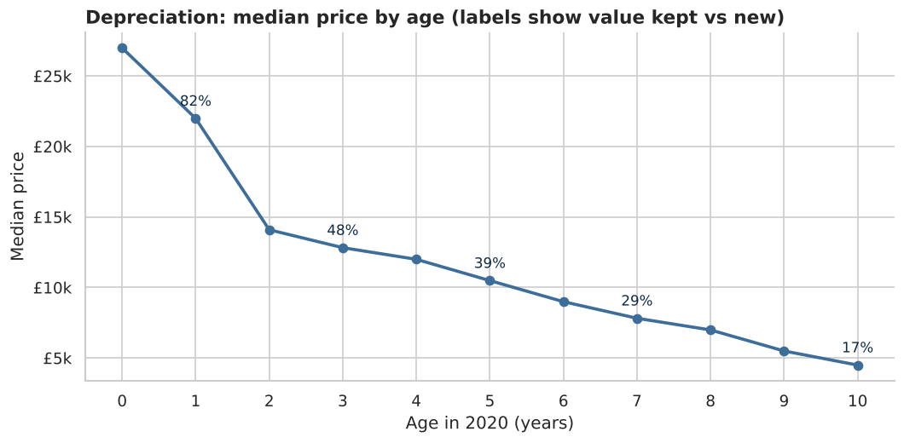
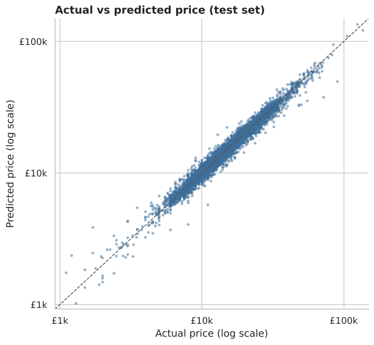

# UK Used Car Price Prediction

Analysis of 96,726 UK used car listings and a Gradient Boosting model that estimates a fair price from a car's make, model, age, mileage and specification. On unseen listings it is accurate to within 6.6% on average (R2 0.970).

**Live demo:** LIVE_DEMO_URL



## Problem

Buyers and dealers need a quick, fair price for a used car. This project answers:

1. Which features drive used car prices?
2. How fast do cars lose value, and which brands hold value best?
3. How accurately can a price be predicted from basic listing details?

## Dataset

Based on the [100,000 UK Used Car Data set](https://www.kaggle.com/datasets/adityadesai13/used-car-dataset-ford-and-mercedes) on Kaggle, saved as `data/uk_used_cars.csv`. 97,712 listings collected in 2020 from nine manufacturers: Audi, BMW, Ford, Hyundai, Mercedes, Skoda, Toyota, Vauxhall and Volkswagen.

| Column | Description |
|---|---|
| model | Car model, 196 in total |
| year | Registration year |
| price | Listed price in pounds (target) |
| transmission | Manual, Automatic or Semi-Auto |
| mileage | Miles driven |
| fuelType | Petrol, Diesel, Hybrid, Electric or Other |
| tax | Annual road tax in pounds |
| mpg | Fuel economy in miles per gallon |
| engineSize | Engine size in litres |
| Manufacturer | Brand |

## Data cleaning

| Issue | Action |
|---|---|
| 985 listings with no price | Dropped |
| One car registered in 2024 in data collected in 2020 | Dropped as an entry error |
| Manufacturer labels `hyundi` and `merc` | Renamed to Hyundai and Mercedes |
| Model names starting with a space | Trimmed |
| Engine size of 0 on non-electric cars (260 rows) | Treated as missing |
| Missing fuel type (3.3%), mpg (2.6%) and engine size (0.3%) | Filled inside the model pipeline with the most frequent value or median from the training data |
| Registration year | Converted to age in 2020 |

Price outliers are kept. Expensive cars are real listings, and removing them would stop the model from pricing them.

## Key findings

- **Cars lose half their value in two years.** The median price falls from £26,990 for cars under one year old to £14,095 at two years. A 10-year-old car keeps 17%.
- **Brand matters for value retention.** After three years, Vauxhall and Mercedes keep 62 to 64% of their price, while Toyota keeps 42%.
- **Engine size has the strongest link with price** (correlation 0.65). Age (-0.49) and mileage (-0.42) push prices down and are closely linked to each other (0.74).
- **Automatics and semi-automatics list for about twice the price of manuals** (median £19,250 and £22,265 against £11,000). Hybrids and diesels list above petrol cars.

| Manufacturer | Listings | Median price |
|---|---|---|
| Mercedes | 12,737 | £22,299 |
| BMW | 10,563 | £20,250 |
| Audi | 10,453 | £20,000 |
| Volkswagen | 14,740 | £15,490 |
| Skoda | 6,131 | £12,998 |
| Hyundai | 4,730 | £11,990 |
| Ford | 17,627 | £11,287 |
| Toyota | 6,626 | £10,797 |
| Vauxhall | 13,119 | £9,998 |

## Model

Features: manufacturer, model, transmission, fuel type, age, mileage, road tax, mpg and engine size. Prices are right-skewed (skewness 2.37), so every model is trained on log(price) and scored in pounds.

### Results

Same 80/20 split for every model (19,346 test listings).

| Model | MAE | MAPE | R2 |
|---|---|---|---|
| Baseline (median price) | £6,775 | 47.0% | -0.050 |
| Ridge Regression | £2,120 | 13.2% | 0.862 |
| Random Forest | £1,138 | 7.2% | 0.966 |
| **Gradient Boosting** | **£1,072** | **6.6%** | **0.970** |

- 5-fold cross-validated R2 for Gradient Boosting: 0.965 on average (0.960 to 0.971).
- 79% of test predictions are within 10% of the real price. The median error is 5.2%.
- Permutation importance: the car model matters most (shuffling it adds about £4,000 of error), then age, mileage and engine size.



### Leakage fix

The first version of this project created a `price_per_mileage` feature by dividing price by mileage. Because it contains the price, it became the second most important feature and inflated the score. It also cannot be calculated for a car whose price is unknown. It has been removed. The notebook shows the effect side by side:

| Features | MAE | R2 |
|---|---|---|
| Without price_per_mileage | £1,183 | 0.962 |
| With price_per_mileage | £403 | 0.985 |

The first version also had a model comparison table that showed identical scores for Linear Regression and Random Forest (both rows used the same variables), and it removed 38% of the data with outlier filters. Both are fixed.

## Web app

- **Price a car:** pick a make and model, set year, mileage and specification, and get an estimated price with a likely range and the median of similar listings
- **Market overview:** prices by manufacturer, fuel type, transmission and engine size
- **Depreciation:** price by age and value kept by manufacturer
- **Model:** results and the leakage fix
- **Data and cleaning:** cleaning log, missing values and a download of the cleaned data

## Tech stack

Python, Pandas, NumPy, Matplotlib, Seaborn, scikit-learn, Streamlit, Jupyter Notebook

## Project structure

```
car-price-prediction/
├── app.py                              Streamlit app
├── data/
│   └── uk_used_cars.csv                Raw listings
├── notebooks/
│   └── car_price_prediction.ipynb      Cleaning, analysis, modeling and findings
├── reports/
│   ├── figures/                        Charts exported by the notebook
│   ├── model_comparison.csv
│   └── feature_importance.csv
├── src/
│   ├── analysis.py                     Cleaning, summaries and charts
│   └── model.py                        Pipelines, evaluation and leakage check
├── requirements.txt
└── README.md
```

## Run locally

```bash
git clone https://github.com/Qasim00760/car-price-prediction.git
cd car-price-prediction
pip install -r requirements.txt
streamlit run app.py
```

To run the notebook:

```bash
pip install notebook
jupyter notebook notebooks/car_price_prediction.ipynb
```

## Author

Muhammad Qasim
[Portfolio](https://qasim.devsil.com) | [LinkedIn](https://www.linkedin.com/in/muhammad-qasim-1944b8349) | [GitHub](https://github.com/Qasim00760)
